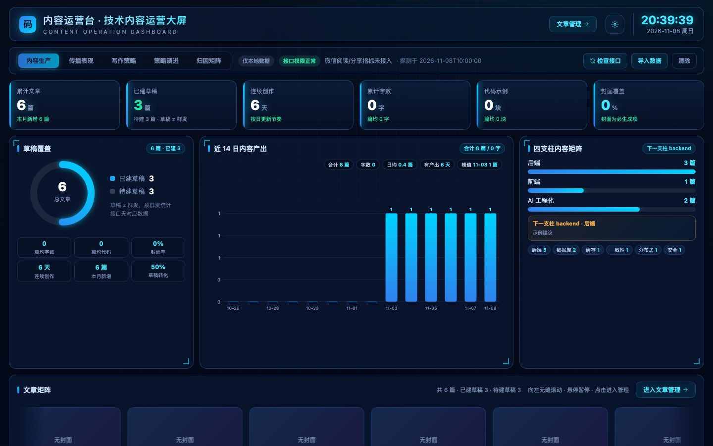
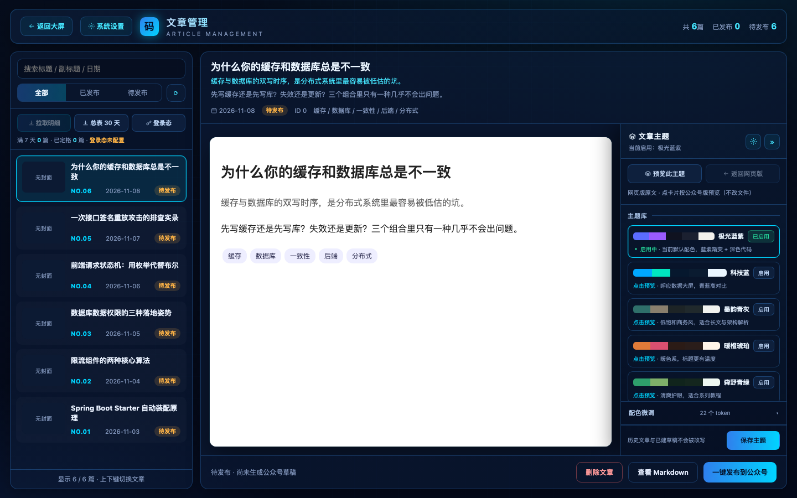
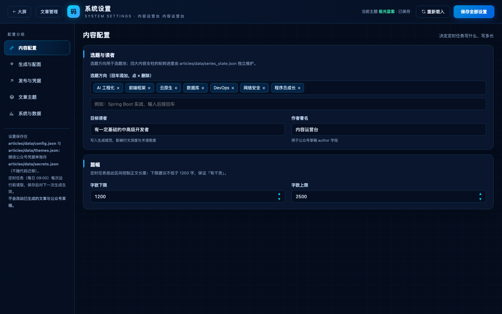
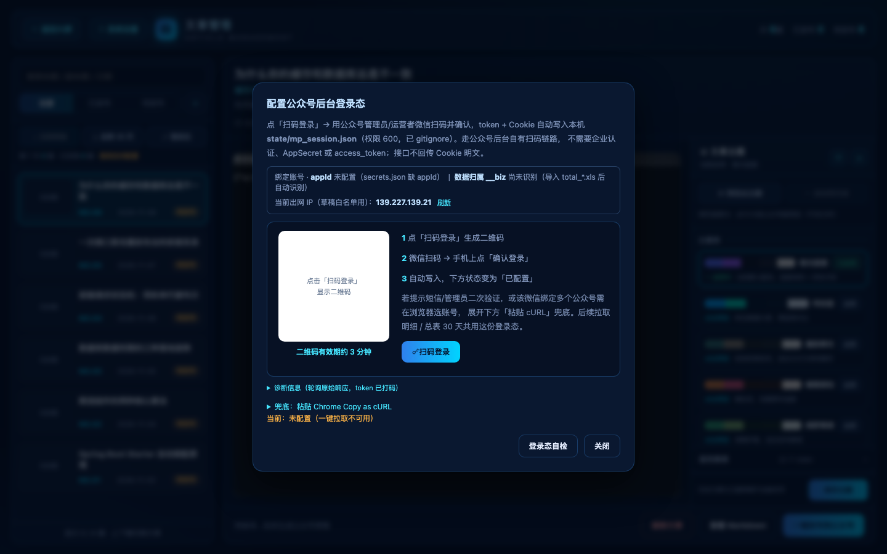

# 内容运营台 · 微信公众号本地运营控制台

> 一套跑在自己机器上的公众号内容运营工具：文章预览、一键建草稿、扫码登录、后台数据导入、指标大屏、写作策略闭环、主题定制。
> **纯本地，仅监听 `127.0.0.1`；数据不出本机；不调用任何大模型 API。**

> 📌 **第一次用？直接按顺序读：一（选模式）→ 二（安装）→ 三 或 四（照着操作）。**
> 第六章往后是配置细节、原理与维护者内容，用到再查，不影响上手。

---

## 一、先选一种用法（最重要）

这个包有**两种用法，不配定时任务也完全能用**。

| | **模式 A · 手动使用** | **模式 B · 定时任务** |
|---|---|---|
| 谁写文章 | 你自己写，或在 WorkBuddy 里让 Agent 写 | 每天 09:00 由 Agent 自动写 |
| 要不要额外配置 | 不用，装完就能用 | 需要一份编排 Skill + 一条自动化任务 |
| 到点电脑要不要开着 | 不用，想用才启动 | 要开机且 WorkBuddy 在运行 |
| 产出 | 文章 + 你点按钮建草稿 | 每天一篇 + 自动建草稿 + 运行台账 |
| 适合 | 偶尔发、想完全掌控 | 日更、想省事 |

**一个关键认知**：包本体 = 一个本地 Web 控制台 + 一组命令行能力（预览 / 质检 / 建草稿 / 看数据 / 算策略）。
「定时任务」**不是包自带的后台服务**，它是 WorkBuddy 的一条自动化，负责每天喊 Agent 来写一篇。
所以：**装完 Skill 不会自动出现按钮，也不会自己每天跑**——这是正常的，按第三章手动用即可。

---

## 二、安装

### 方式 1：作为 WorkBuddy Skill 安装（推荐）

```bash
# 用户级 Skill 目录（所有项目可用）
git clone git@github.com:scpuny/daily-article-skill.git \
  ~/.workbuddy/skills/wechat-article-studio
# 或用 HTTPS / 下载 zip 解压到同一目录
```
然后**重启 WorkBuddy**。之后在对话里直接说需求即可，例如：

> 「帮我启动内容运营台」　／　「按内容运营台写一篇文章」　／　「导入这份后台数据」

Agent 会读 `SKILL.md`，替你完成复制应用包、启动服务、执行命令等动作，并把访问链接给你。
> Skill 提供的是**应用包 + 操作指令**，不是常驻服务；Web 控制台需要显式启动（见下方命令）。

### 方式 2：不用 WorkBuddy，只跑 Web 控制台

```bash
# 1) 取应用包（只需 assets/app/）
cp -R <本包目录>/assets/app ~/wechat-studio
cd ~/wechat-studio

# 2) 启动（清代理变量，避免本地请求被代理干扰）
env -u HTTP_PROXY -u HTTPS_PROXY -u ALL_PROXY \
  python3 src/app.py --mode web --port 8731

# 3) 打开
#    http://127.0.0.1:8731/manage     文章管理（日常入口）
#    http://127.0.0.1:8731/           运营大屏（指标）
#    http://127.0.0.1:8731/settings   系统设置
```

### 首次准备清单（两种装法都要做，按顺序）

| # | 做什么 | 具体位置 / 命令 | 不做会怎样 |
|---|---|---|---|
| 1 | Python **3.10+** | `python3 --version` | 起不来 |
| 2 | 可选依赖（见下） | `python3 -m pip install requests xlrd` | 基础控制台能跑，但**建草稿**和**真 `.xls` 导入**会失败 |
| 3 | 建凭据文件 | `cp data/secrets.json.example data/secrets.json`，填入自己的 `appId` / `appSecret` | 扫码登录、预览可用；草稿发布与数据接口不可用 |
| 4 | 改基础配置 | `data/config.json` 里的 `author`（署名）、`topics`（选题）、`autoPublish` | 署名不对 / 草稿不会自动建 |
| 5 | 启动服务 → 扫码登录 → 加 IP 白名单 | 见第六章 | 草稿接口报 IP 白名单错误 |

**依赖说明（诚实版）**：控制台、预览、策略计算、大屏指标**只用 Python 标准库，零依赖**；
只有两处按需装包 —— `publish_wechat.py` 发布草稿用 `requests`，`excel_import.py` 解析真 `.xls` 用 `xlrd`。
CSV / HTML 表格导入不依赖 `xlrd`。装了也不影响其他部分。

> `state/`（登录态、缓存、质检报告、运行台账）在首次运行后自动生成，**不要提交、不要随包分发**。

---

## 三、模式 A：不配定时任务，日常怎么用

把控制台当「**手动驾驶舱**」：你（或 Agent）负责写文章，工具负责预览、质检、建草稿、看数据、算策略。

### A-1 一篇文章从写到发（5 步）

| 步 | 操作 | 位置 / 命令 |
|---|---|---|
| 1 | **写文章** | 最省事：在 WorkBuddy 对话里说「按内容运营台写一篇关于 X 的文章」。Agent 会按 `references/daily-workflow.md` 走一遍流程——**这是一次手动触发，不是定时任务**。也可自己把 `.html` / `.md` 放进 `data/content/<YYYY-MM>/` |
| 2 | **登记到台账** | 在第 1 步由 Agent 完成；纯手工时把记录**插入 `data/index.json` 列表最前面**（按日期倒序，id=0 最新）。字段见下方 |
| 3 | **预览 + 切主题** | `/manage` → 左侧选文章 → 右侧实时预览 → 顶部切主题 |
| 4 | **建草稿** | `/manage` → 点「**一键发布到公众号**」。只建草稿、**不群发** |
| 5 | **后台确认** | 公众号后台 → 草稿箱 → 确认内容 → 群发；**原创声明要手动勾**（接口不支持） |

`data/index.json` 记录字段（路径都要带 `<YYYY-MM>/` 前缀）：
```json
{"date":"2026-11-08","title":"…","subtitle":"…","summary":"…","tags":[],
 "html":"2026-11/2026-11-08-xxx.html","md":"2026-11/2026-11-08-xxx.md",
 "cover":"2026-11/assets/xxx-cover.png","publish":null,"quality":null}
```
> 只写实际存在的文件，缺失字段留 `null`；管理台、画廊、大屏都依赖这个顺序。

### A-2 看数据与策略（想看才做，不必每天）

- **导入后台数据**：公众号后台「内容分析 / 图文分析 → 下载数据明细」拿到 `total_*.xls`。
  两条入口等价：① 放进 `~/Downloads`，下次算策略时自动吸收；② `/manage` →「导入数据」上传。
  按日期 + 标题 UPSERT，**不覆盖**既有行。
- **刷新接口数据 / 清除导入数据**：`/settings` 页两个按钮；需要 `appSecret` 且接口已授权。
- **大屏看什么**：`/` 下的传播表现（发文×阅读相关系数、快照健康度）、写作策略（样本漏斗、配对诊断）、
  策略演进（规则状态、缺口值）、归因矩阵（命中组 vs 控制组 lift）。
- **策略闭环**：`constraints[]` 是给**下一篇写作**用的硬约束，不是给人看的图表；样本 < 8 篇时走冷启动基线，不会编造数据。

### A-3 命令速查（可不敲，UI 基本都点得到）

所有命令在工作目录执行，`--mode cli` 必须写在子命令前：

| 想做什么 | 命令 |
|---|---|
| 启动控制台 | `python3 src/app.py --mode web --port 8731` |
| 取本轮写作策略 | `python3 src/app.py --mode cli strategy_engine.py get` |
| 质检最新一篇 | `python3 src/app.py --mode cli lint --check-latest` |
| 本地预览排版（不联网） | `python3 src/app.py --mode cli publish --html <绝对路径> --config data/config.json --dry-run --out /tmp/p.html` |
| 建草稿 | `python3 src/app.py --mode cli publish --html <绝对路径> --config data/config.json --title "<标题>"` |
| 重建画廊 | `python3 src/app.py --mode cli gallery` |
| 看运行台账 | `python3 src/app.py --mode cli runs --list` |
| 草稿箱对账 | `python3 src/app.py --mode cli reconcile` |

### A-4 推荐节奏

| 频率 | 建议动作 |
|---|---|
| 每写完一篇 | 预览 →（可选）质检 → 一键建草稿 |
| 每周 | 导出一次后台数据并导入；看一眼大屏传播表现 |
| 每月 | 看策略演进，把验证有效的规则写入写作 Skill；草稿箱对账 |

---

## 四、模式 B：配置定时任务（每天自动一篇）

### B-0 四个前提

1. 已完成第二章的安装与首次准备，`secrets.json` 已填、扫码登录有效。
2. 每天 09:00 电脑**开机且未休眠**，WorkBuddy 在运行（定时任务由它调度）。
3. 有一份「每日创作编排 Skill」——**包里已附通用模板** `references/daily-workflow.md`。
4. 想清楚 `autoPublish`：`true` = 写完自动建草稿；`false` = 只生成文章，草稿由你手动点。

### B-1 步骤 1：把编排模板放成一份 Skill

```bash
# 项目级（推荐，跟工作目录走）
mkdir -p <APP_HOME>/.workbuddy/skills/daily-article
cp <本包目录>/references/daily-workflow.md \
   <APP_HOME>/.workbuddy/skills/daily-article/SKILL.md

# 或用户级（所有项目可用）
mkdir -p ~/.workbuddy/skills/daily-article
cp <本包目录>/references/daily-workflow.md ~/.workbuddy/skills/daily-article/SKILL.md
```
`APP_HOME` = 你放 `assets/app` 的工作目录（如 `~/wechat-studio`）。
这份模板规定了「取策略 → 选题写作 → 归档 → 质检 → 建草稿 → 写台账 → 登记特征」的顺序与硬约束。
**它是通用版**，你可以按自己的选题体系、文风、支柱规则改写。

### B-2 步骤 2：创建定时任务

**方式 a · 直接对 WorkBuddy 说一句话（最省事）**

> 创建一个每天 09:00 执行的定时任务：读取 `~/.workbuddy/skills/daily-article/SKILL.md`，
> 严格按其中流程写一篇中文技术文章并建公众号草稿（不群发），失败也要写运行台账；
> 工作目录设为 `~/wechat-studio`。

WorkBuddy 会生成一条 recurring 自动化。**方式 b** 是它背后的字段，手动核对时用：

| 字段 | 填什么 |
|---|---|
| 名称 | 每日文章创作 |
| 类型 | 周期性（recurring） |
| 频率 | `FREQ=DAILY;BYHOUR=9;BYMINUTE=0`（每天 09:00；换成别的时刻改 `BYHOUR`） |
| 工作目录 `cwds` | `APP_HOME` 的**绝对路径** |
| `prompt` | 见下方模板 |

`prompt` 模板（复制后把两个占位符换成你的真实路径）：
```text
读取 <编排 Skill 的绝对路径>/SKILL.md，严格按其中第 2 节顺序执行：
取写作策略并逐条落实 constraints[] → 按四支柱轮转选题 → 写作与配图 →
月份归档并把记录插入 data/index.json 最前面 → 重建画廊 → lint 质量闸门 →
（autoPublish=true 时）建公众号草稿 → 写运行台账 → 登记本轮特征与假设 → 汇报。

工作目录：<APP_HOME 绝对路径>；命令一律在该目录下执行。
SKILL.md 中的 wb_* MCP 工具若当前会话未注册，一律走其第 3 节 CLI 回退命令，
不要跳过步骤、不要自行简化流程（两者共用 src/core，产物一致）。
硬约束：只建草稿不群发；原创需后台手动勾选；lint 有 error 不建草稿；
不伪造统计指标；凭据只从 data/secrets.json 读取，绝不写进文章、日志或汇报。
失败也要写一条运行台账并如实说明原因。
```

### B-3 步骤 3（可选）：注册 MCP，让它走工具而不是命令行

**不配也能跑**——模板里有完整 CLI 回退。若想让定时任务调用 `wb_*` 工具，把下面条目**合并**
进 `~/.workbuddy/mcp.json` 的 `mcpServers`（不要覆盖已有条目），然后在连接器管理里信任并启用：

```json
{
  "mcpServers": {
    "wechat-studio": {
      "type": "stdio",
      "command": "<python3 解释器的绝对路径>",
      "args": ["<APP_HOME>/src/app.py", "--mode", "mcp", "--home", "<APP_HOME>"]
    }
  }
}
```

### B-4 步骤 4：验证它真的跑起来了

1. **先手动触发一次**：对 WorkBuddy 说「现在按每日创作流程跑一次」，别等到第二天才发现配错。
2. 检查四样东西：
   - `data/content/<YYYY-MM>/` 有新文章与封面
   - `state/lint_report.json` 的 `ok`
   - `state/runs/<YYYY-MM-DD>.json` 有一条台账（**失败也会写**，`error` 字段就是原因）
   - 公众号后台草稿箱多了一篇
3. 回看台账：`python3 src/app.py --mode cli runs --list`

| 现象 | 先查什么 |
|---|---|
| 到点没跑 | 电脑休眠 / WorkBuddy 没开 / 任务不是 ACTIVE / `cwds` 路径写错 |
| 有文章没草稿 | `autoPublish=false`、登录态过期、出网 IP 变了（换网络要重加白名单） |
| lint 一直不过 | `state/lint_report.json` 的 `errors`；常见是路径缺 `<YYYY-MM>/` 前缀、封面缺失 |
| 定时任务想停 | 把自动化暂停或删除即可，**数据不丢**，随时回到模式 A |

> 两种模式共用同一份 `data/`：手动写的和自动写的文章都在同一个台账、同一套策略样本里，可随时切换。

---

## 五、配置详解

### `data/secrets.json`（**不随包提供**，需自行创建）
```json
{ "appId": "wxYOUR_APPID_HERE", "appSecret": "YOUR_APPSECRET_HERE" }
```
从公众号后台「设置与开发 → 基本配置」获取。
- `appId`：扫码登录的 `login_appid`，也用于身份展示。
- `appSecret`：仅数据接口（datacube）需要；**扫码登录本身不需要**。

### `data/config.json`（随包提供，可改）
| 字段 | 含义 |
|---|---|
| `topics` / `audience` | 选题方向（数组）/ 目标读者 |
| `author` | 署名（建草稿时的作者名） |
| `wordRange` | 正文字数区间 `[1200, 2500]`，质检按它判定 |
| `themeName` | 默认主题 |
| `imageStyle` / `skipImages` | 配图风格 / 跳过配图 |
| `autoPublish` | `true` 生成后自动建草稿；`false` 只生成文章 |
| `publishTarget` | 发布目标（如 `wechat`） |

设置页 `/settings` 可可视化改上述字段，改完点「保存全部设置」。

---

## 六、扫码登录与 IP 白名单

公众号草稿接口受 **IP 白名单**限制，认的是**后端 Python 向 `mp.weixin.qq.com` 出网的 IP**，
不是浏览器 IP —— 必须把弹窗里显示的那个 IP 加进公众号后台白名单。

1. `/manage` → 右上角「**登录态**」→ 弹窗。
2. 点「**扫码登录**」生成二维码 → 用管理员 / 运营者微信扫码并确认。
3. 弹窗内「**当前出网 IP（草稿白名单用）**」即需加白的 IP；换网络或重启后点「刷新」重取。
4. 遇短信二次验证 / 多微信多公众号时，展开「粘贴 cURL」兜底：
   登录后台 → F12 → Network → 任选一条 `mp.weixin.qq.com` 请求 → 右键 **Copy as cURL (bash)** → 粘贴保存。

> 登录态落在 `state/mp_session.json`（权限 600），可复用；「登录态自检」只验证能否拉到数据、不下载文件。

---

## 七、数据导入

在公众号后台「内容分析 / 图文分析 → 下载数据明细」拿到 `total_*.xls`：

- 解析阅读 / 分享 / 收藏 / 在看等指标，UPSERT 进本地指标缓存（按日期 + 标题去重，**不覆盖**既有行）。
- 首次导入含「内容 url」的表格后会自动识别账号归属 `__biz`，并在账号卡片展示。
- 批量 `total_*.xls` 只含阅读 / 分享；**收藏、在看、点赞在单篇明细 xls 里**，
  放进 `~/Downloads` 或在管理台上传后按标题配对补全。
- 跨账号导入只会**告警**、不会改写原账号绑定。
- 真 `.xls` 需要 `xlrd`；CSV / HTML 表格不需要。

---

## 八、写作策略闭环（原理，可略读）

`src/core/strategy_engine.py` 从阅读反馈里归纳写作规律，**纯标准库确定性计算，不调用任何模型 API**：

- 输入：`strategy_log.jsonl`（文章特征）、`feedback.jsonl`（指标）、`external_signals.jsonl`（外部选题信号）。
- 输出：`data/writing_strategy.json` —— `constraints[]`、句式权重、置信度，供下次写作当硬约束。
- 样本 < 8 篇用冷启动基线，8–20 篇贝叶斯收缩；黏性以分享 / 收藏 / 在看为准。
- 附带一致性体检与自愈（台账错位、数值分叉）；`backfill` 可在换机器时回填历史特征。

---

## 九、主题定制

`/settings` →「文章主题」切换内置主题，或基于 22 个设计 token 自定义保存；定义在 `data/themes.json`。
网页版 `:root` 与公众号发布器读同一份 active 主题，配色一致。

---

## 十、运行页面截图

> 截图均使用**通用示例数据**生成，不含任何真实账号信息。（截图为指标化改造前版本，界面布局一致。）

### 运营大屏


### 文章管理（预览 + 发布）


### 系统设置


### 登录态弹窗（扫码 + 出网 IP）


---

## 十一、系统架构（开发者）

```
<本包>/                          # Skill 包
├── SKILL.md                      # 给 WorkBuddy Agent 读的指令
├── README.md                     # 本文件
├── references/
│   ├── architecture.md           # 架构与数据流
│   └── daily-workflow.md         # 每日创作编排模板（定时任务用）
├── assets/
│   ├── app/                      # 可运行应用（复制它即可独立部署）
│   └── screenshots/              # 运行截图
├── scripts/build_skill.py        # 一键重建脱敏包
└── dist/                         # 打包产物（不入库）

assets/app/
├── src/app.py                    # 唯一入口：--mode web | mcp | cli
├── src/paths.py                  # 路径层（data/ 与 state/ 定位）
├── src/web/                      # admin_server.py + 三个页面
├── src/core/                     # 登录/发布/统计/策略/质检/主题/台账
├── src/mcp/server.py             # 可选 stdio MCP
└── data/                         # config / themes / index / secrets 模板
```

三种入口：
```bash
python3 src/app.py --mode web --port 8731        # Web 控制台
python3 src/app.py --mode mcp --home <目录>      # stdio MCP，由宿主拉起
python3 src/app.py --mode cli lint --check-latest # 透传执行 core 脚本
```
账号身份（`login_appid` / `__biz`）完全由配置与数据驱动，不写死在代码里——换公众号只改 `secrets.json` + `config.json`。

---

## 十二、隐私与分发声明（重要）

本包**刻意不包含**任何真实隐私信息：

- ❌ 不含 `appId` / `appSecret` / 登录 token / Cookie（`secrets.json`、`state/` 均被排除）。
- ❌ 不含真实文章内容与真实阅读数据（`data/content/`、`state/` 运行态不进包；`index.json` 为空数组）。
- ❌ 不含真实账号标识（`__biz`、真实微信号）。
- ✅ 品牌名统一泛化为「内容运营台」；`secrets.json` 仅以 `.example` 占位模板提供。

**因此可直接分享给他人安装，不会泄露你的公众号隐私。**
使用者自己的凭据与文章数据只存在他本机，与本仓库无关。

---

## 十三、常见问题（FAQ）

**Q：装完 Skill 后没看到任何按钮 / 它没自动跑？**
A：正常。Skill 是给 Agent 读的指令 + 应用包，不是常驻服务。在对话里说「帮我启动内容运营台」让 Agent 起服务；想每天自动跑，按第四章配定时任务。

**Q：不配定时任务能用吗？**
A：完全能，见第三章。定时任务只是「每天自动喊 Agent 写一篇」，控制台的预览、发布、导入、大屏都不依赖它。

**Q：定时任务和手动模式会冲突吗？**
A：不会，共用同一份 `data/`。任务暂停后随时可回到手动，历史文章与策略样本都在。

**Q：到点没执行？**
A：电脑休眠、WorkBuddy 未运行、`cwds` 路径写错、任务被暂停，按第四章 B-4 逐项查；台账 `state/runs/` 会记录失败原因。

**Q：文章生成了但草稿箱没有？**
A：依次查 `autoPublish`、`secrets.json`、登录态是否过期、出网 IP 是否换了（重加白名单）、lint 是否有 error 阻断。

**Q：需要公网 / 域名 / 服务器吗？**
A：不需要，服务仅监听 `127.0.0.1`。但**定时任务模式**要求到点本机开着 WorkBuddy。

**Q：点「登录态自检」没反应？**
A：它只弹一条短暂提示、不下载文件。确认提示是否一闪而过；本质是验证登录态能否拉到数据。

**Q：为什么大屏首屏是空的？**
A：远程指标来自后台数据导入。首次未导入时本地指标（文章数、连续创作天数）仍会显示。

**Q：能多账号吗？**
A：单实例单账号；换账号改 `secrets.json` + `config.json`。跨账号导入会告警但不串号。

---

## 十四、从 GitHub 获取与重新打包（维护者）

仓库地址：`https://github.com/scpuny/daily-article-skill.git`（推送走 SSH 免令牌）。

### 重新打包
```bash
cd <本包目录>
python3 scripts/build_skill.py                              # 重建 assets/app/ + 产出 dist/*.zip
python3 scripts/build_skill.py --src /path/to/your/articles # 指定源工程
python3 scripts/build_skill.py --no-zip                     # 仅重建，不打 zip
```
> 不带 `--src` 时会自动探测源工程：优先 `ARTICLES_SRC` 环境变量，其次当前目录 / 上级的 `articles/`，
> 再到 `~/WorkBuddy/*/articles`；都找不到会明确提示你显式指定 `--src`。脚本不含任何硬编码本机路径。

脚本会：① 复制源工程 `src/` 与 `data/` 白名单；② 泛化品牌名；③ 剔除真实凭据 / 登录态 / 业务数据；
④ 打包后做**隐私兜底扫描**，命中真实 `appId` / `__biz` / token / 原品牌名 / 真实文章索引立即报错中止。

> `dist/` 是可再生二进制，已加入 `.gitignore`，不入库。手写文档（`README.md` / `SKILL.md` / `references/` / 截图）会被原样保留。

### 标准手动同步流程
```bash
python3 ~/.workbuddy/skills/wechat-article-studio/scripts/build_skill.py \
  --src /path/to/your/articles

cd ~/.workbuddy/skills/wechat-article-studio
git add -A && git commit -m "chore: 同步代码" && git push
```

### 提交后自动同步（可选）
在本地开发工程里加 `post-commit` 钩子，每次提交自动重建脱敏包：

1. 用**白名单式** `.gitignore`（`/*` 默认忽略一切，仅放行 `src/`、`scripts/`、`docs/`），把 `data/`、`state/`、真实凭据挡在门外；
2. `scripts/post-commit.sh`（随仓库跟踪）核心：
```bash
ARTICLES_DIR="$(git rev-parse --show-toplevel)"
SKILL_DIR="${SKILL_DIR:-$HOME/.workbuddy/skills/wechat-article-studio}"
python3 "$SKILL_DIR/scripts/build_skill.py" --src "$ARTICLES_DIR"
```
3. `.git/hooks/post-commit` 做转发器并 `chmod +x`：
```bash
#!/bin/bash
ROOT="$(git rev-parse --show-toplevel)" || exit 0
[ -x "$ROOT/scripts/post-commit.sh" ] && exec "$ROOT/scripts/post-commit.sh"
exit 0
```
> 钩子只在本地运行，只把脱敏副本写进 Skill 目录，不会把真实数据带进任何仓库；退出码不影响已完成的提交。分发仓库仍需手动 `git push`。

---

## 许可

本工具按「自用 / 内部分发」提供，凭据与账号数据由使用者自行负责。
